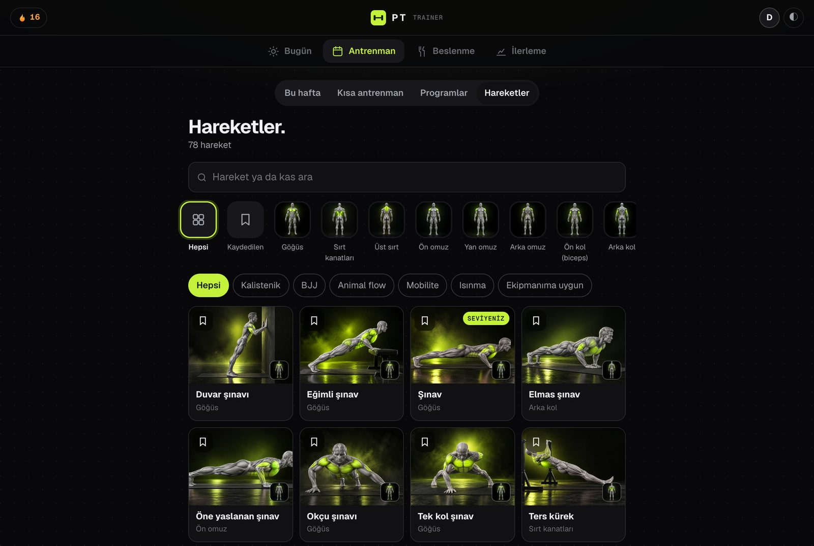
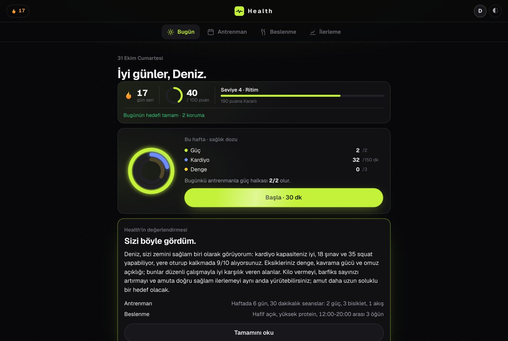
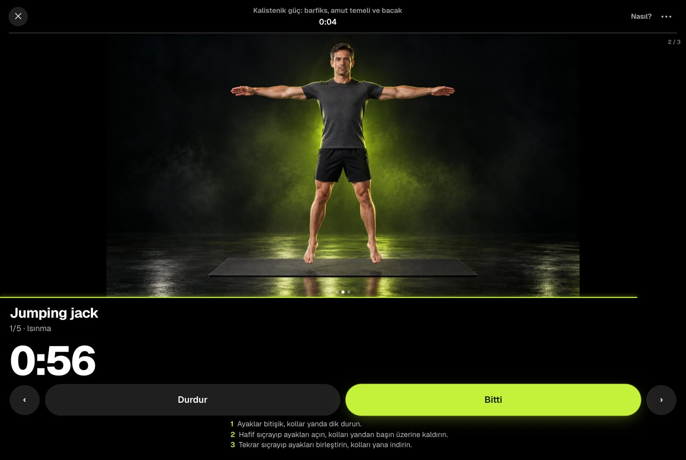
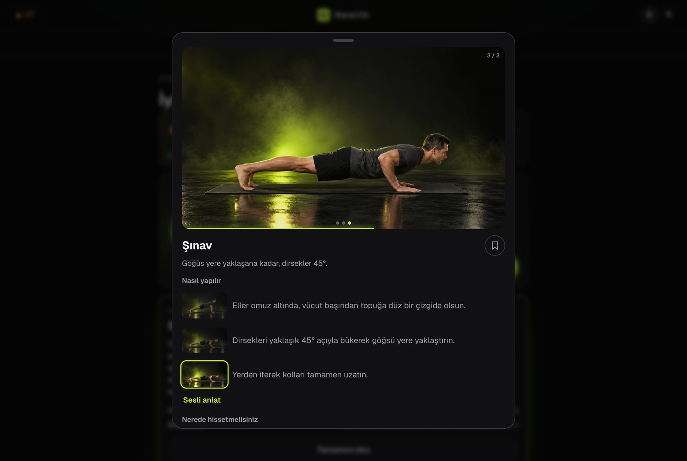
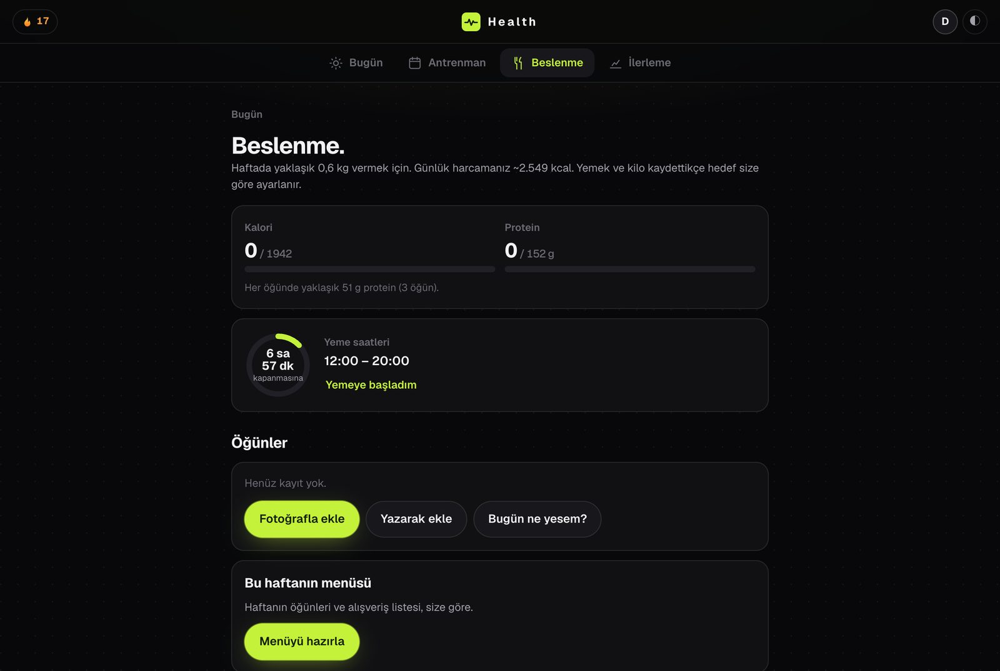
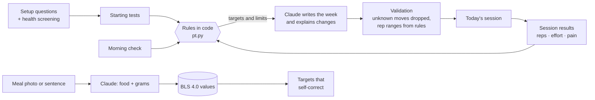

<div align="center">


# PT

**A personal trainer and nutrition coach that lives on your Mac.**

It gets to know you, tests where you are, writes your week, adjusts every morning to how you slept,
counts your sets out loud, and tells you *why* it changed something.




</div>

> **Heads-up:** the app interface is in **Turkish** today. The code, docs and this page are in English, and
> [translations are the most wanted contribution](#contributing).

---

## Why PT

Most fitness apps hand you a list of workouts. A good coach does something else: they ask questions, test you,
watch how you respond, and change the plan for a reason they can explain. PT tries to be that coach.

- **It adapts to today, not to an average you.** A 30-second morning check (sleep, energy, aches) turns the day
  green, yellow or red. Yellow drops a set and keeps reps in reserve. Red turns the session into mobility or an
  easy ride.
- **The rules are code, not vibes.** Progression, regression, pain limits and deload weeks are fixed rules you
  can read in the app. Claude writes the plan *within* those rules and explains every change. Every change can be undone.
- **The numbers come from tables, not from a language model.** Meal estimates are matched to the German food
  database (BLS 4.0); the model only picks which food it is and how many grams.
- **Your data stays home.** Profile, workouts, weight, meal photos: all in a folder on your Mac.

## A day with PT

**Morning.** Answer three taps of questions. The session for today appears, already adjusted: the right progression step for each movement, the right number of sets, a 10-minute version if you are short on time. Your streak counts any finished session, even 10 minutes.

<p align="center"></p>

**Training.** A full-screen player walks you through every set and rest: photo storyboard, three-step how-to, rep counter, rest timer, coach voice and beeps. After the last set: *Easy, Good or Hard?*

<p align="center"></p>

**Learning a movement.** Every one of the 78 movements has a three-frame storyboard, the common mistakes, where you should feel it, the muscles involved, an easier and a harder step, and a curated YouTube walkthrough.

<p align="center"></p>

**Eating.** Snap a photo or type *"two-egg menemen, a slice of bread, 30 g feta"*. You get grams and macros per item, each with its source. Calorie and protein targets correct themselves from your weigh-ins.

<p align="center"></p>

On Sunday you get a short coach message (what went well, what changes next week, one habit to keep) and next
week's plan is written with it.

## What's inside

**Training**
- Calisthenics progressions: wall push-up → push-up → archer → one-arm; dead hang → negatives → pull-up → muscle-up;
  wall walk → chest-to-wall → freestanding handstand; sit-to-stand → squat → shrimp → pistol; tuck front lever.
- Mobility, animal flow, solo jiu-jitsu drills (with a class log that finds your weak positions), cycling routes
  with wind and rain checks (BRouter + OpenStreetMap, GPX export).
- 8 ready programs (*First pull-up*, *Handstand path*, *Pistol path*, *Strong core*, *14-day mobility*, *Desk worker's back*…),
  quick workouts from 5 to 45 minutes built from your current level, an exercise library with search by muscle.
- Optional form check: film a set from the side; macOS Vision counts reps and measures depth and lockout.

**Coaching**
- Setup by tap, not by form: one question per screen, a free-text note only if you want to add something.
- Pre-exercise health screening (PAR-Q+) and a hard stop with clear instructions if you report warning signs.
- Two-question pain check after sessions; joint pain is followed up the next morning, muscle burn is not.
- Talk to PT in plain language (*"my knee hurts"*, *"I only have 15 minutes"*, *"I'm travelling this week"*);
  it asks one follow-up question and proposes a change you can apply with one tap.

**Nutrition**
- Targets from Mifflin–St Jeor and the training you actually did, protein 1.6–2.2 g/kg, fibre and saturated fat limits.
- Eating window with a simple *"I've started eating / I've had my last meal"*.
- Weekly menu and shopping list, barcode lookup (Open Food Facts), *same as yesterday* logging.

**Progress**
- Duolingo-style streak with streak freezes and a repair window, 39 badge levels, a weekly ring.
- Strength tests every five weeks, weight trend (smoothed), readiness and fatigue from training load.

## Who it's for

- You train at home, in a park or a small gym, mostly with bodyweight, a bar and a mat.
- You want structure that bends around real life instead of a fixed 12-week plan.
- You'd rather keep health data on your own machine.
- You're curious how to build a local-first app where an LLM **writes and explains** but fixed rules **decide**.

It is probably not for you if you mainly lift barbells (no load tracking for heavy lifts yet) or if you need an
English interface today.

## Install

You need a Mac with Apple silicon (M1 or newer), macOS 14 or newer, [Homebrew](https://brew.sh) and Git.

```bash
git clone https://github.com/yehsohimself/pt.git
cd pt
./kurulum.sh
.venv/bin/python pt_sunucu.py
```

Open **http://127.0.0.1:8771**. From then on, double-click `PT.command`.

`kurulum.sh` installs `ffmpeg` and `uv` with Homebrew, creates a Python 3.12 environment in `.venv` and downloads the
exercise pictures and coach voice (about 45 MB) from the [latest release](https://github.com/yehsohimself/pt/releases/latest).
No `sudo`, nothing installed outside the folder except the two Homebrew tools.

### Connect Claude (for plans and meal photos)

Writing the weekly plan, reading meal photos, the menu and the coach messages use Claude through **your own**
subscription. Install [Claude Code](https://claude.com/claude-code) and sign in once:

```bash
claude auth login
```

Without it PT still runs the morning check, the player, the progression rules, streaks and manual logging,
but it cannot write a new plan.

### First run

About two minutes of questions (goal, experience, schedule, equipment, aches, eating habits, health screening),
then a seven-step **first week**: two short tests that set your level, then 10–15 minute sessions. After that PT
writes full weeks.

## Your data

| What | Where |
|---|---|
| Profile, workouts, weight, pain notes, meal photos | `pt/` on your Mac, never uploaded |
| Text and photo needed for a writing task (plan, meal estimate, coach message) | Claude, only when that task runs |
| Start area of a bike route, weather | OpenStreetMap search, BRouter, Open-Meteo (no account) |
| Barcode of a packaged food | Open Food Facts (no account) |
| Monthly check for new training research | PubMed (no account) |

The server listens on `127.0.0.1` only and refuses requests coming from other websites.

## How it works



| File | Role |
|---|---|
| `pt.py` | Catalogue, progression chains, rules, morning light, plan validation |
| `pt_site.py` | API (Flask) |
| `pt_sunucu.py` | Standalone server on 127.0.0.1:8771 |
| `pt_beslenme.py`, `pt_bls.py`, `pt_yemek.py` | Targets, meal estimates, BLS lookup, weekly menu |
| `pt_oyun.py` | Streak, freezes, badges, daily tasks |
| `static/pt.html` | The whole interface, vanilla JS |

Identifiers and comments are in Turkish (the project started as a personal tool). Tests:

```bash
.venv/bin/python -m pytest tests -q
```

## Limits

- Interface in Turkish only, for now.
- Apple silicon only (macOS Vision for form checks, MLX for the coach voice).
- Coach voice clips ship pre-generated; new sentences need the optional local voice model.
- Not a medical device. PT gives general training and nutrition guidance; it does not diagnose.

## Contributing

The most useful help right now:

1. **English interface.** Strings live in `static/pt.html` and in the prompts in `pt*.py`. A dictionary-based
   approach (like the sibling project [Studio](https://github.com/yehsohimself/studio)) is the plan.
2. **Coaches and physios:** read the rules in `pt.py` (`KURALLAR_METNI`, progression chains) and open an issue
   if something is wrong or unsafe.
3. **Movements:** missing progressions, better cues, better videos.

Bug reports are welcome; please say what you tapped and what you expected.

## Credits

Food values: Max Rubner-Institut, *Bundeslebensmittelschlüssel* 4.0, CC BY 4.0 (see `modeller/bls/LISANS.md`).
Routes: [BRouter](https://brouter.de) and OpenStreetMap contributors. Weather: [Open-Meteo](https://open-meteo.com).
Barcodes: [Open Food Facts](https://openfoodfacts.org).

## License

MIT. See [LICENSE](LICENSE).

> **Not medical advice.** PT is a training and nutrition helper, not a doctor or physiotherapist. If you have a
> medical condition, pain that does not go away, or you are unsure whether exercise is safe for you, talk to a
> doctor first.

---

<details>
<summary><b>Türkçe</b></summary>

PT, Mac'inizde çalışan kişisel antrenör ve beslenme koçu. Seçenekli sorularla sizi tanır, başlangıç testiyle
seviyenizi ölçer, haftanızı yazar, her sabah uyku ve enerjinize göre günü ayarlar, setleri sesli sayar ve bir
şeyi neden değiştirdiğini söyler. İlerleme kuralları kodda ve uygulamada görünür; kalori değerleri BLS 4.0
tablosundan gelir. Verileriniz Mac'inizde kalır. Kurulum: yukarıdaki dört komut, sonra tarayıcıda
http://127.0.0.1:8771. Plan ve yemek fotoğrafı için Claude Code girişi gerekir. Tıbbi tavsiye değildir.

</details>
