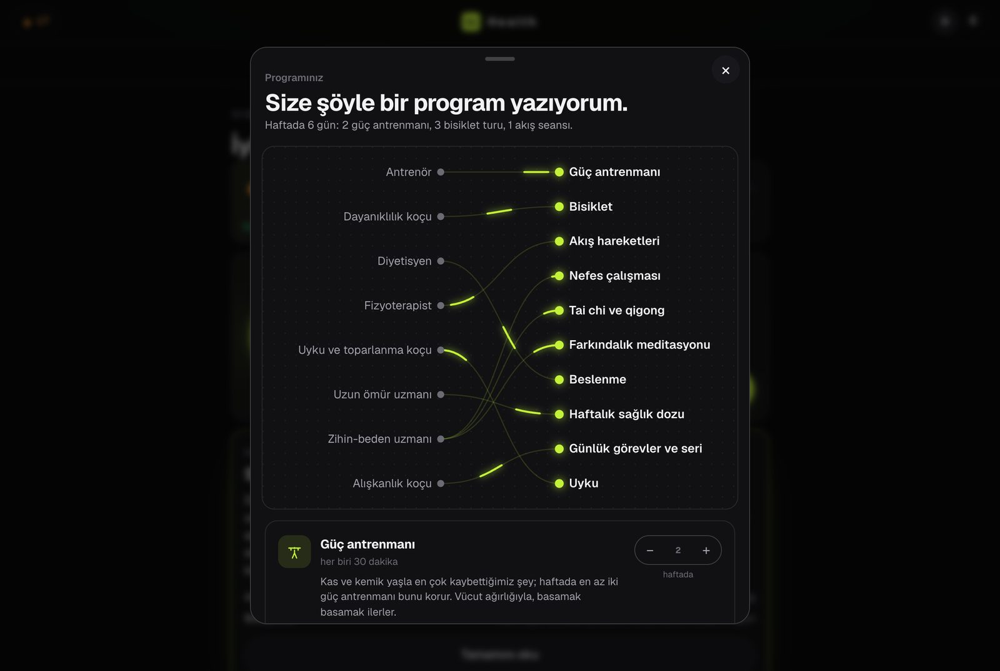
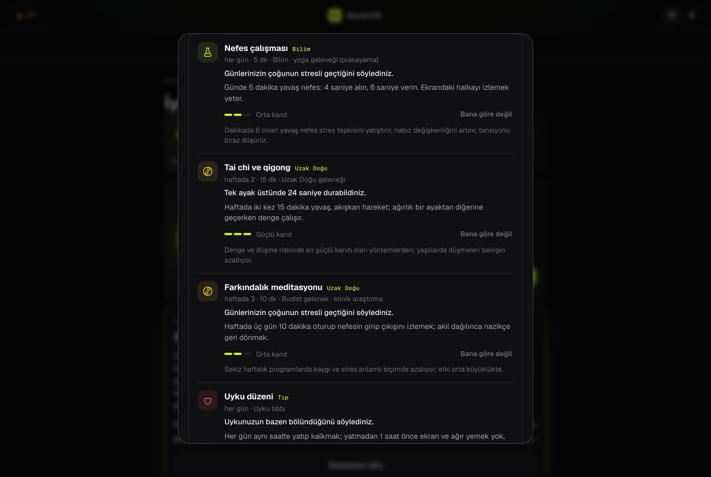
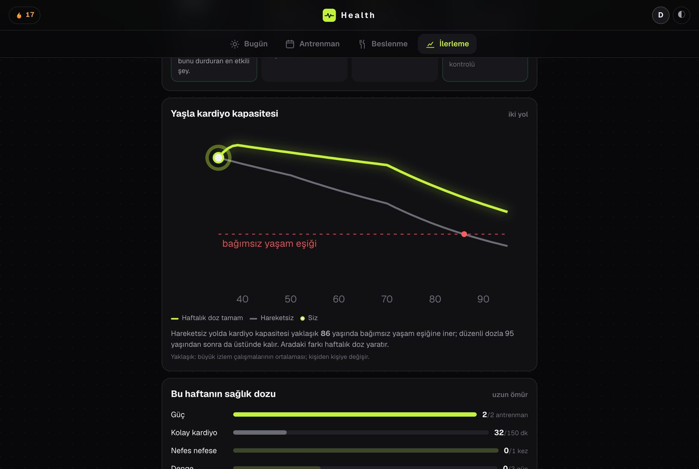
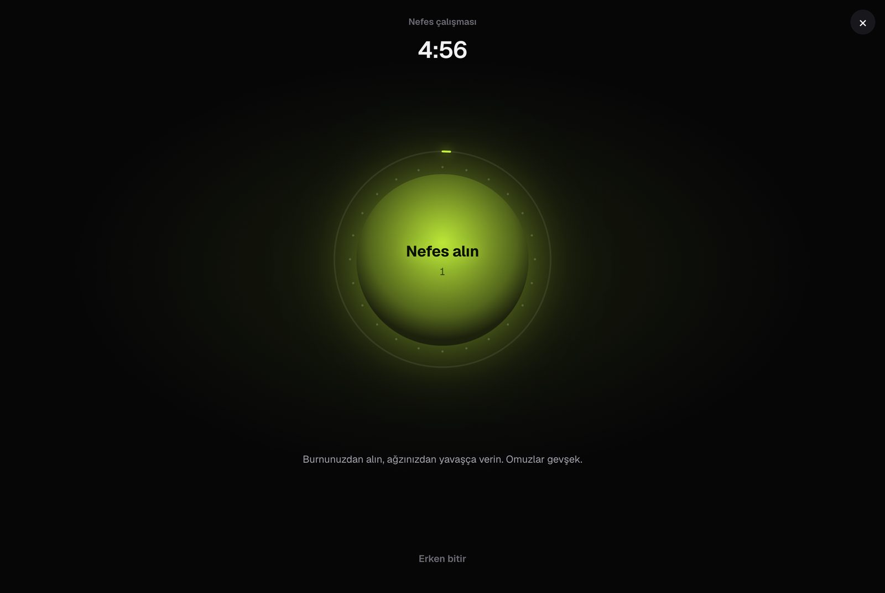
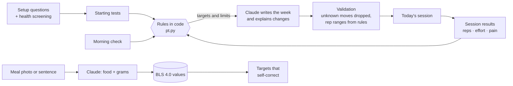

<div align="center">


# Health

**A health team that lives on your Mac: trainer, endurance coach, dietitian, physio, sleep coach, longevity specialist and a mind-body coach.**

You describe your needs and your life. Health decides what your week is made of, tells you *why*, adjusts every morning,
counts your sets out loud, and keeps nudging you toward a long, healthy life.


</div>

> **Heads-up:** the app interface is in **Turkish** today. The code, docs and this page are in English, and
> [translations are the most wanted contribution](#contributing). Formerly called *PT*.

---

## Why Health

Most fitness apps hand you a list of workouts. A good team of specialists does something else: they ask about your life,
measure where you are, decide the mix, watch how you respond, and change it for a reason they can explain.

- **You never pick methods.** Setup asks what you enjoy, which days you have, how stressed you are, how you sleep, what
  hurts. Health composes the program: strength, easy cardio, one hard session, balance, mobility, your classes as fixed days.
- **Modular, and it follows your trajectory.** On top of training, Health adds small *modules* when your signals call for
  them: slow breathing, mindfulness, tai chi and qigong, morning light, a sleep routine, movement breaks, a nature walk,
  eating to 80% full. Each one shows where it comes from (science, modern medicine, East Asian traditions, nature), how strong
  the evidence is, and the reason it was chosen for you. When a need disappears the module leaves; when a new one shows up
  it joins, and every change can be undone.
- **Built for a long, healthy life.** A weekly longevity dose, ageing markers, and a chart that shows the two roads your
  cardio fitness can take with age.
- **The rules are code, not vibes.** Progression, pain limits, deload weeks and safety rules are fixed code you can read.
  Claude writes and explains within them.
- **The numbers come from tables.** Meals are matched to the German food database (BLS 4.0).
- **Your data stays home.** Profile, workouts, weight, meal photos: all in a folder on your Mac.

## Motion that explains

- **Weekly rings** fill as you train (strength, cardio, balance), with the planned part shown faintly behind, and a line
  telling you what today's session does to them.
- **The team diagram**: light flows from each specialist to the part of the program they own.
- **The two roads**: estimated cardio fitness against age, sedentary versus with the weekly dose, with the independent-living
  threshold and your own point pulsing on it.
- **A breathing player**: a glowing sphere that grows on the inhale and shrinks on the exhale, with a progress halo.
- **Movement storyboards** that flow back and forth between start, middle and end pose.

<p align="center"></p>
<p align="center"></p>
<p align="center"></p>
<p align="center"></p>

## A day with Health

**Health speaks first.** Open the app and Health says one short, personal thing about where you are: *"Yesterday's match at
the stadium was a hard one, your legs are probably heavy. Today's 10-minute test can wait until the evening if you like."*
Below it, the replies you would most likely give, one of which starts the session. Answer with a tap, or say something else.

**Talk back, out loud or in writing.** A bar at the bottom of every screen: type or tap the microphone (speech is turned into
text on your own Mac with Whisper; nothing leaves the computer). Ask *why* a test is in the plan, push back, log a football
match or a lunch in one sentence. Health answers like a person, asks a follow-up with tappable choices when it needs one, and can
drop a card into the conversation: start today's session, your weekly dose, a breathing exercise, your weight curve. Every
question in setup, in the morning check and in the coach interviews has *"Say something else"* and *"I have a question"*.

**Your week as a story.** On Sunday and Monday, a full-screen recap you tap through: the days you moved, minutes by activity,
the moment of the week, your longevity-dose rings, steps, sleep and weight from Apple Health, and one sentence for next week.
Every number is counted from your logs; a card without data is simply left out.

**Morning.** Three taps for the morning check, and the session for today appears, already adjusted: the right progression step for each movement, the right number of sets, a 10-minute version if you are short on time. Your streak counts any finished session, even 10 minutes.

<p align="center"></p>

**Training.** A full-screen player walks you through every set and rest: photo storyboard, three-step how-to, rep counter, rest timer, coach voice and beeps. After the last set: *Easy, Good or Hard?*

<p align="center"></p>

**Learning a movement.** Every one of the 78 movements has a three-frame storyboard, the common mistakes, where you should feel it, the muscles involved, an easier and a harder step, and a curated YouTube walkthrough.

<p align="center"></p>

**Eating.** Snap a photo or type *"two-egg menemen, a slice of bread, 30 g feta"*. You get grams and macros per item, each with its source. Calorie and protein targets correct themselves from your weigh-ins.

<p align="center"></p>

On Sunday you get a short coach message (what went well, what changes next week, one habit to keep) and next
week's plan is written with it.

**You describe your life, Health composes the program.** Setup never asks *"how many calisthenics sessions do you want?"*.
It asks what you enjoy (jiu-jitsu, walking, cycling, bodyweight at home…), which days you have, how long, what hurts. Then a
team of specialists (trainer, endurance coach, dietitian, physio, sleep coach, longevity specialist, habit coach, and a
jiu-jitsu coach if you train) answers with *"here is the program I'm writing for you"*: two strength sessions, easy cardio,
one hard session, balance and mobility, with your classes as fixed days, one reason per line, and counts you can change.

**Built for a long, healthy life.** Every week has a minimum *longevity dose*: at least two strength sessions, easy cardio
minutes, one breathless session, balance on three days, seven hours of sleep. Health measures it from what you actually logged and
shows it next to the plan. It also tracks the markers that best predict healthy ageing: estimated VO2max (from Apple Health or
resting heart rate), the sit-to-stand floor test, one-leg balance, grip (dead hang), push-up and squat strength, waist-to-height
ratio and resting heart rate. The weakest one shapes the next block.

**After the intake, Health tells you what it concluded.** Like a real trainer at the end of a first session: how it sees you, which training
approach and which nutrition approach fit you and *why*, what to watch, the first three steps. The numbers in it (calories, protein, test
results, progression steps) come from code; the model only explains them.

**Three goals, set together.** Four weeks, three months, one year. Health proposes measurable candidates it can actually track (weight trend, a
test result, the next progression step, number of sessions, a streak), you accept, swap or write your own. Progress is measured from your
records, not from your feeling.

**A check-in every 14 days.** Health reads the last two weeks (adherence, effort ratings, pain, sleep, weight trend against the expected pace,
goal progress), asks three or four short questions and decides, with reasons, whether the program stays or changes. Safe changes are
applied (session length, number of days, weight-loss pace); the rest goes into next week's plan.

## What's inside

**Training**
- Calisthenics progressions: wall push-up → push-up → archer → one-arm; dead hang → negatives → pull-up → muscle-up;
  wall walk → chest-to-wall → freestanding handstand; sit-to-stand → squat → shrimp → pistol; tuck front lever.
- Mobility, animal flow, solo jiu-jitsu drills (with a class log that finds your weak positions), cycling routes
  with wind and rain checks (BRouter + OpenStreetMap, GPX export).
- 8 ready programs (*First pull-up*, *Handstand path*, *Pistol path*, *Strong core*, *14-day mobility*, *Desk worker's back*…),
  quick workouts from 5 to 45 minutes built from your current level, an exercise library with search by muscle.
- Optional form check: film a set from the side; macOS Vision counts reps and measures depth and lockout.

**Coaching**
- Setup by tap, not by form: one question per screen, a free-text note only if you want to add something.
- Pre-exercise health screening (PAR-Q+) and a hard stop with clear instructions if you report warning signs.
- Two-question pain check after sessions; joint pain is followed up the next morning, muscle burn is not.
- Talk to Health in plain language, by typing or by voice (*"my knee hurts"*, *"I only have 15 minutes"*, *"why this test?"*);
  it answers, asks a follow-up with choices when needed, logs what you did, and proposes plan changes you apply with one tap.

**Nutrition**
- Targets from Mifflin–St Jeor and the training you actually did, protein 1.6–2.2 g/kg, fibre and saturated fat limits.
- Eating window with a simple *"I've started eating / I've had my last meal"*.
- Weekly menu and shopping list, barcode lookup (Open Food Facts), *same as yesterday* logging.

**Progress**
- Duolingo-style streak with streak freezes and a repair window, 43 badge levels, a weekly ring.
- Points and levels: every record earns points (session, morning check, meals, tasks, records, progression steps), a daily 100-point
  goal, three optional bonus tasks a day, twelve levels. Nothing is stored as a counter; it is recomputed from your logs, so a late or
  corrected entry fixes itself.
- Today's plan as a timeline: what to do at what time and why, with the done items ticked off.
- Strength tests every five weeks, weight trend (smoothed), readiness and fatigue from training load.

## Who it's for

- You train at home, in a park or a small gym, mostly with bodyweight, a bar and a mat.
- You want structure that bends around real life instead of a fixed 12-week plan.
- You'd rather keep health data on your own machine.
- You're curious how to build a local-first app where an LLM **writes and explains** but fixed rules **decide**.

It is probably not for you if you mainly lift barbells (no load tracking for heavy lifts yet) or if you need an
English interface today.

## Install

You need a Mac with Apple silicon (M1 or newer), macOS 14 or newer, [Homebrew](https://brew.sh) and Git.

```bash
git clone https://github.com/yehsohimself/health.git
cd health
./kurulum.sh
.venv/bin/python pt_sunucu.py
```

Open **http://127.0.0.1:8771**. From then on, double-click `Health.command`.

`kurulum.sh` installs `ffmpeg` and `uv` with Homebrew, creates a Python 3.12 environment in `.venv` and downloads the
exercise pictures and coach voice (about 45 MB) from the [latest release](https://github.com/yehsohimself/health/releases/latest).
No `sudo`, nothing installed outside the folder except the two Homebrew tools.

### Connect Claude (for plans and meal photos)

Writing the weekly plan, reading meal photos, the menu and the coach messages use Claude through **your own**
subscription. Install [Claude Code](https://claude.com/claude-code) and sign in once:

```bash
claude auth login
```

Without it Health still runs the morning check, the player, the progression rules, streaks and manual logging,
but it cannot write a new plan.

### First run

About two minutes of questions (goal, experience, schedule, equipment, aches, eating habits, health screening),
then a seven-step **first week**: two short tests that set your level, then 10–15 minute sessions. After that Health
writes full weeks.

## Your data

| What | Where |
|---|---|
| Profile, workouts, weight, pain notes, meal photos | `pt/` on your Mac, never uploaded |
| Text and photo needed for a writing task (plan, meal estimate, coach message) | Claude, only when that task runs |
| Start area of a bike route, weather | OpenStreetMap search, BRouter, Open-Meteo (no account) |
| Barcode of a packaged food | Open Food Facts (no account) |
| Monthly check for new training research | PubMed (no account) |

The server listens on `127.0.0.1` only and refuses requests coming from other websites.

## How it works



| File | Role |
|---|---|
| `pt.py` | Catalogue, progression chains, rules, morning light, plan validation |
| `pt_site.py` | API (Flask) |
| `pt_sunucu.py` | Standalone server on 127.0.0.1:8771 |
| `pt_beslenme.py`, `pt_bls.py`, `pt_yemek.py` | Targets, meal estimates, BLS lookup, weekly menu |
| `pt_oyun.py` | Streak, freezes, badges, daily tasks |
| `pt_uzun.py` | Weekly program mix from needs, longevity dose, ageing markers |
| `pt_modul.py` | Modules chosen from your signals (breathing, tai chi, sleep, light…), evidence levels, safety rules |
| `pt_hedef.py`, `pt_kontrol.py` | Three-horizon goals, intake assessment, 14-day check-ins |
| `static/pt.html` | The whole interface, vanilla JS |

Identifiers and comments are in Turkish (the project started as a personal tool, then called PT, hence the `pt_` file names). Tests:

```bash
.venv/bin/python -m pytest tests -q
```

## Limits

- Interface in Turkish only, for now.
- Apple silicon only (macOS Vision for form checks, MLX for the coach voice).
- Coach voice clips ship pre-generated; new sentences need the optional local voice model.
- Not a medical device. Health gives general training and nutrition guidance; it does not diagnose.

## Contributing

The most useful help right now:

1. **English interface.** Strings live in `static/pt.html` and in the prompts in `pt*.py`. A dictionary-based
   approach (like the sibling project [Studio](https://github.com/yehsohimself/studio)) is the plan.
2. **Coaches and physios:** read the rules in `pt.py` (`KURALLAR_METNI`, progression chains) and open an issue
   if something is wrong or unsafe.
3. **Movements:** missing progressions, better cues, better videos.

Bug reports are welcome; please say what you tapped and what you expected.

## Credits

Food values: Max Rubner-Institut, *Bundeslebensmittelschlüssel* 4.0, CC BY 4.0 (see `modeller/bls/LISANS.md`).
Routes: [BRouter](https://brouter.de) and OpenStreetMap contributors. Weather: [Open-Meteo](https://open-meteo.com).
Barcodes: [Open Food Facts](https://openfoodfacts.org).

## License

MIT. See [LICENSE](LICENSE).

> **Not medical advice.** Health is a training and nutrition helper, not a doctor or physiotherapist. If you have a
> medical condition, pain that does not go away, or you are unsure whether exercise is safe for you, talk to a
> doctor first.

---

<details>
<summary><b>Türkçe</b></summary>

Health, Mac'inizde çalışan kişisel antrenör ve beslenme koçu. Seçenekli sorularla ihtiyacınızı ve şartlarınızı öğrenir, programın
yapısını kendisi kurar ("Size şöyle bir program yazıyorum"), uzun ve sağlıklı yaşam için haftalık dozu (güç, kolay kardiyo, denge)
ve yaşlanma göstergelerini ölçer, bilimden, modern tıptan ve Uzak Doğu geleneklerinden modülleri (nefes, tai chi, uyku düzeni, sabah ışığı) ihtiyacınıza göre kendisi ekleyip çıkarır, başlangıç testiyle
seviyenizi ölçer, haftanızı yazar, her sabah uyku ve enerjinize göre günü ayarlar, setleri sesli sayar ve bir
şeyi neden değiştirdiğini söyler. İlerleme kuralları kodda ve uygulamada görünür; kalori değerleri BLS 4.0
tablosundan gelir. Verileriniz Mac'inizde kalır. Kurulum: yukarıdaki dört komut, sonra tarayıcıda
http://127.0.0.1:8771. Plan ve yemek fotoğrafı için Claude Code girişi gerekir. Tıbbi tavsiye değildir.

</details>
